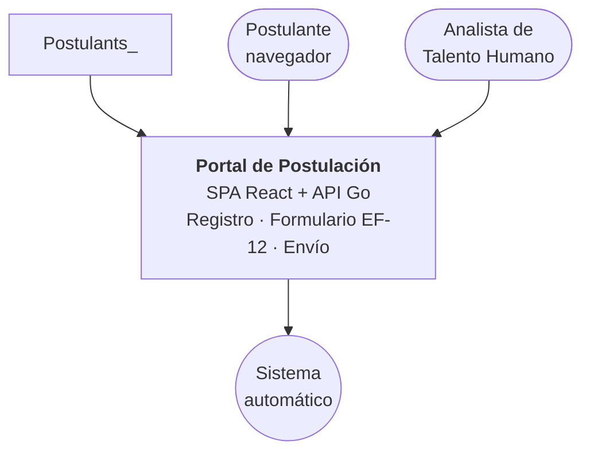
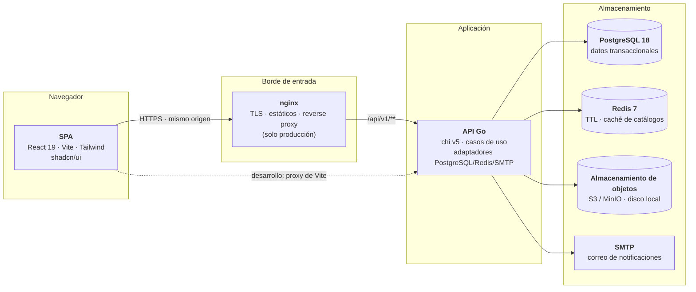
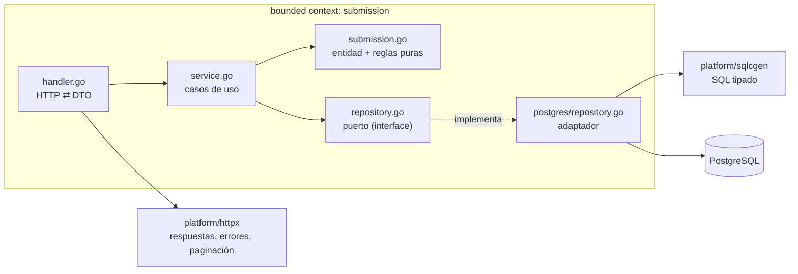
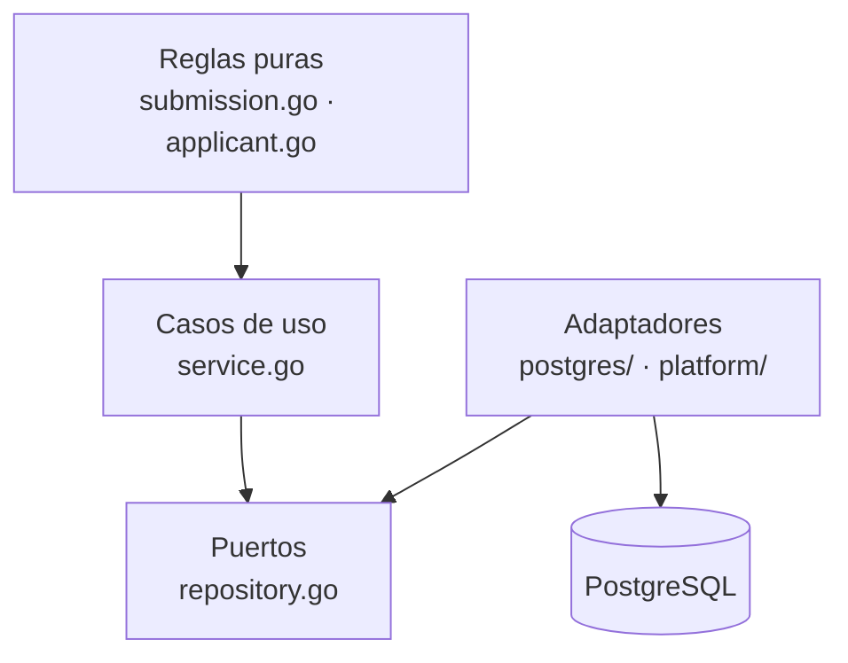
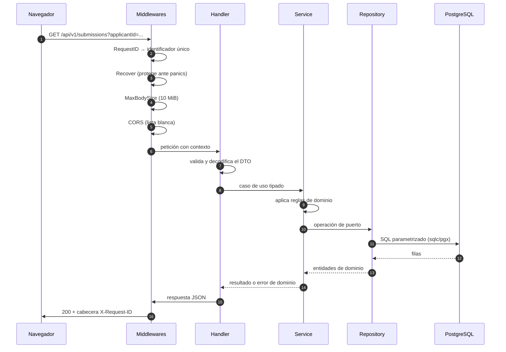
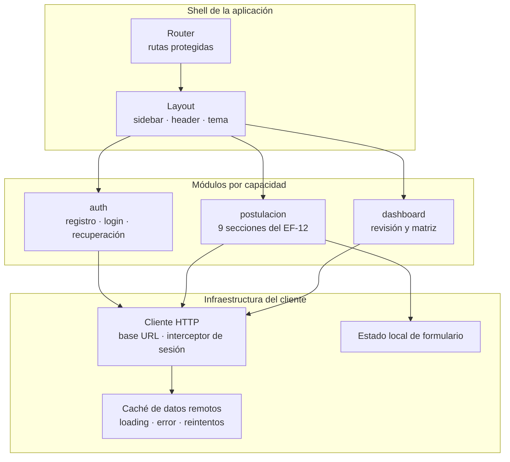

# Arquitectura del sistema

**Sistema de Registro y Postulación al Directorio del BIESS**
Documento de arquitectura v1.0

| Campo | Valor |
|---|---|
| Documento | ARQUITECTURA v1.0 |
| PRD asociado | [`../prd/PRD.md`](../prd/PRD.md) |
| TRD asociado | [`../trd/TRD.md`](../trd/TRD.md) |
| Alcance | Módulo inicial de registro y postulación (EF-11, EF-12, parte de EF-13) |

---

## 1. Principios

1. **Desacoplamiento por dominio.** Cada *bounded context* es dueño de su
   modelo y de sus reglas. Los contextos no comparten entidades: comparten
   contratos (puertos) y datos referenciales por identificador.
2. **El dominio no depende de la infraestructura.** Las reglas de negocio no
   importan `pgx`, `redis` ni `net/http`. Eso permite probar la lógica sin
   base de datos.
3. **Inyección de dependencias por constructor.** Cada caso de uso recibe sus
   colaboradores en el constructor. El cableado ocurre en un único lugar:
   `apps/backend/cmd/api/main.go`.
4. **Una sola fuente de verdad para el contrato HTTP.** Los códigos de error y
   las formas de paginación se definen una vez y se reutilizan.
5. **Un solo origen en producción.** nginx sirve la SPA y reenvía `/api`, así
   no hay CORS ni cookies cross-origin.
6. **El dato sensible no sale del servidor.** Los documentos de los
   postulantes se guardan fuera del árbol de la aplicación y no se registran en
   los logs.

---

## 2. Vista de contexto



El registro y la recuperación usan **OTP por correo** y validación de cédula por
módulo 10. No hay consulta al Registro Civil ni se solicitan fecha de expedición
o código dactilar; los datos personales no disponibles en la cuenta se declaran
en EF-12. [ADR-008](../decisions/ADR-008-registro-y-recuperacion-con-otp.md) registra
la adaptación aprobada del RF. La situación laboral es una capacidad separada,
con un puerto para el proveedor y un adaptador simulado de servidor mientras no
haya acceso al Historial Laboral (T17); una bandera enviada por el cliente no
constituye esa verificación.

---

## 3. Vista de contenedores



| Contenedor | Responsabilidad | Estado |
|---|---|---|
| SPA | Formularios, feedback inmediato, rutas protegidas | Parcial (dashboard y utilidades implementados) |
| nginx | Único puerto público; sirve la SPA y reenvía `/api` | Implementado en `deploy/` |
| API Go | Casos de uso, validaciones, transacciones, caché | Parcial (contexto `submission` completo) |
| PostgreSQL | Persistencia transaccional | Implementado (2 tablas) |
| Redis | Bloqueo de intentos y caché de catálogos | **Pendiente** |
| Objetos | PDFs de respaldo | Parcial (backend local en disco) |
| SMTP | Confirmaciones y recuperación de contraseña | Implementado |

---

## 4. Vista de componentes del backend

**T8/T9 (2026-10-31):** `internal/audit/` consulta el historial y proporciona
eventos de negocio transaccionales; `internal/review/` concentra nóminas selladas,
conteos y exportaciones privadas por período. Las rutas administrativas conservan
los permisos de T6. No son la gestión de fases de T18 ni una matriz de méritos
aprobada. Contratos y límites: [REVIEW_AUDIT.md](../api-contracts/REVIEW_AUDIT.md).

El backend se organiza en **bounded contexts**. Cada contexto agrupa sus
capacidades; cada capacidad se compone de archivos con una responsabilidad
única:

```text
internal/<contexto>/<capacidad>/
├── service.go     # casos de uso: orquestan la lógica y aplican las reglas
├── handler.go     # adaptador HTTP: traducen HTTP ⇄ dominio
├── repository.go  # puerto: interfaces que el dominio necesita
├── dto.go         # objetos de entrada/salida de la capa HTTP
├── errors.go      # errores del dominio, con código estable
└── postgres/      # adaptador de persistencia (implementa el puerto)
```

El contexto `submission` es la **referencia de implementación** del proyecto:
es el único que recorre el ciclo completo (dominio → servicio → puerto →
adaptador → SQL) y sirve de plantilla para los demás.



### 4.1 Reglas de dependencias



- Las **reglas puras** no importan nada de infraestructura: son funciones
  deterministas sobre valores.
- Los **casos de uso** dependen solo de interfaces declaradas en su propio
  paquete (los puertos) y del kernel compartido.
- Los **adaptadores** implementan esos puertos y traducen errores de
  infraestructura a errores de dominio.
- `internal/shared/domain/` contiene únicamente primitivas transversales
  (errores base y paginación). Nada de negocio.
- `internal/platform/` contiene lo transversal (configuración, base de datos,
  HTTP, logging, correo, caché, almacenamiento). Sin reglas de negocio.

> **Nota**: no se usan carpetas `domain/`, `application/` e `infrastructure/`.
> La granularidad por archivos dentro del contexto da el mismo desacoplamiento
> con menos ruido. Ver
> [ADR-002](../decisions/ADR-002-bounded-contexts-y-hexagonal.md).

---

## 5. Ciclo de una petición



Puntos clave del ciclo:

1. **Los middlewares se aplican en el router raíz** (`platform/httpx/router.go`),
   no en cada handler. Cada contexto solo registra sus rutas.
2. **El handler no contiene reglas de negocio**: traduce HTTP a una llamada
   tipada al caso de uso.
3. **El servicio no conoce SQL**: habla con el puerto.
4. **Los errores de dominio se traducen una sola vez**, en el handler, a
   códigos HTTP estables (ver §7).
5. **Toda respuesta lleva `X-Request-ID`**, que también aparece en los logs.

---

## 6. Arquitectura del frontend



- **Rutas protegidas**: un guard de sesión consulta la sesión vigente y
  redirige al login si no hay cookie válida. La sesión viaja en cookie
  `HttpOnly`, invisible para JavaScript.
- **Consumo asíncrono**: todas las llamadas usan `async/await` sobre un cliente
  HTTP único; los estados `loading` / `success` / `error` se manejan de forma
  uniforme para que el usuario siempre reciba feedback.
- **Reglas puras en `src/utils/`**: la validación de cédula (módulo 10), la
  fortaleza de contraseña y la duración de la experiencia viven en funciones
  puras con tests en Vitest, y se comparten con el backend como reglas
  equivalentes.
- **Convenciones**: identificadores y dominio en **español**
  (`esValida`, `calcularDuracionExperiencia`, `seccion1`), coherentes con el
  código de negocio del RF.

---

## 7. Manejo de errores

El backend distingue tres familias de errores y cada una tiene un destino
distinto:

| Familia | Ejemplo | Destino |
|---|---|---|
| Error de entrada | JSON malformado, UUID inválido | `400` con código estable |
| Error de dominio | postulación ya enviada, código duplicado | `409` o `404` con código estable |
| Error inesperado | panic, fallo de base de datos | `500` genérico + log con `request_id` |

El envelope es único para toda la API:

```json
{
  "error": {
    "codigo": "postulacion_no_editable",
    "mensaje": "La postulación ya fue enviada y no admite cambios."
  }
}
```

El **código** es estable y es lo que consume el frontend; el **mensaje** está
en español y es lo que ve el usuario final. El detalle técnico nunca se expone
al cliente: va al log, correlacionado por `request_id`.

---

## 8. Transacciones

El guardado de una postulación es multi-tabla (cabecera, secciones,
documentos y eventos de auditoría). `platform/db.TxManager` encapsula
`BEGIN` / `COMMIT` / `ROLLBACK` y lo usa el caso de uso, de modo que ni el
servicio ni el handler conocen la gestión de transacciones:

```go
err := txManager.WithinTx(ctx, func(tx pgx.Tx) error {
    if err := repo.Create(ctx, tx, submission); err != nil {
        return err
    }
    return repo.SaveEvents(ctx, tx, events)
})
```

Consecuencia: o se escribe todo o no se escribe nada; nunca queda una
postulación sin sus documentos.

---

## 9. Caché y control de intentos

Redis cubre los dos requisitos de la rúbrica:

| Uso | Clave | TTL |
|---|---|---|
| Intentos fallidos de autenticación | `identity:login-attempts:{cédula}` | 10 min |
| Bloqueo temporal | `identity:lockout:{cédula}` | 10 min |
| Catálogo de países | `catalog:countries` | 24 h |
| Provincias por país | `catalog:provinces:{país}` | 24 h |
| Cantones por provincia | `catalog:cities:{país}:{provincia}` | 24 h |

El diseño completo (algoritmo de bloqueo, invalidación, diagrama de secuencia)
está en [`../trd/TRD.md` §7](../trd/TRD.md). **Implementación pendiente**: es
el bloque de mayor valor pendiente de la rúbrica
(criterio 3, 6 pts).

---

## 10. Seguridad

| Capa | Control |
|---|---|
| Contraseñas | Argon2id (64 MiB, t=3, p=2) con sal aleatoria de 16 bytes |
| Sesión | Token opaco de 256 bits; en la base solo su SHA-256; cookie `HttpOnly; SameSite=Lax; Secure` |
| Transporte | TLS en el borde; un solo origen en producción |
| CORS | Lista blanca explícita; vacío = denegar todo |
| Cuerpos | 10 MiB por petición + límites por tipo de PDF (2 MB / 4 MB / 50 MB) |
| Panics | Middleware `Recover`: responde JSON 500, nunca corta la conexión |
| Auditoría | `request_id` por petición; eventos append-only por postulación |
| Secretos | Solo variables de entorno; `.env` ignorado, `.env.example` versionado |
| Datos personales | No se registran en logs ni se versionan |

---

## 11. Estrategia de pruebas

| Nivel | Herramienta | Qué cubre |
|---|---|---|
| Dominio (backend) | `go test` | Cédula módulo 10, canonización y hash, estados de la postulación, paginación |
| Dominio (frontend) | Vitest | Validadores (cédula, contraseña), catálogo geográfico, duración de experiencia |
| Contrato HTTP | `go test` + `httptest` | Envelope de error, códigos HTTP, parsers de paginación |
| Integración | `go test` + Postgres real | Consultas keyset, transacciones |
| Extremo a extremo | Pendiente | Recorrido registro → formulario → envío |

Las reglas puras se prueban **sin base de datos**, que es el beneficio directo
de mantener la lógica de negocio fuera de los handlers.

---

## 12. Guía para agregar un bounded context

1. **Crear la carpeta** `internal/<contexto>/` con un `doc.go` que describa el
   contexto en una frase.
2. **Modelar el dominio** en un archivo sin dependencias: entidad, estados,
   invariantes y errores propios en `errors.go`.
3. **Declarar el puerto** en `repository.go`: las operaciones que el caso de
   uso necesita, con tipos del dominio (nunca tipos de SQL).
4. **Implementar el caso de uso** en `service.go`: recibe sus colaboradores
   por constructor, aplica las reglas y devuelve errores de dominio.
5. **Escribir el adaptador** en `postgres/repository.go` implementando el
   puerto, con las queries en `sql/queries/*.sql` y regenerando con `make
   sqlc-generate`.
6. **Exponer el adaptador HTTP** en `handler.go`: DTOs en `dto.go`, traducción
   de errores a códigos HTTP, y `RegisterRoutes(router chi.Router)`.
7. **Cablear** en `cmd/api/main.go`: única línea donde se instancia todo.
8. **Cubrir con tests** las reglas puras del dominio.

---

## 13. Estado de la arquitectura

| Capa | Estado | Pendiente principal |
|---|---|---|
| Bounded contexts y cableado | Implementado | — |
| Transacciones | Implementado | Uso real en el guardado multi-tabla |
| Paginación (offset y cursor) | Implementado | — |
| Redis (bloqueo y caché) | **Pendiente** | Criterio 3 de la rúbrica (6 pts) |
| Contextos `identity`, `document`, `catalog`, `review` | Parcial | EF-11, adjuntos, cascada, dashboard |
| Seguridad (Argon2id, sesiones, cookies) | Parcial | Casos de uso de autenticación |
| Observabilidad | Mínimo | Métricas y trazas |

La lista de trabajo detallado, con la prioridad y el criterio de rúbrica
asociado, está en [`../tasks/`](../tasks/).

---

**Ver también**: [`../trd/TRD.md`](../trd/TRD.md) ·
[`../database/SCHEMA.md`](../database/SCHEMA.md) ·
[`../api-contracts/API_CONTRACT.md`](../api-contracts/API_CONTRACT.md)
