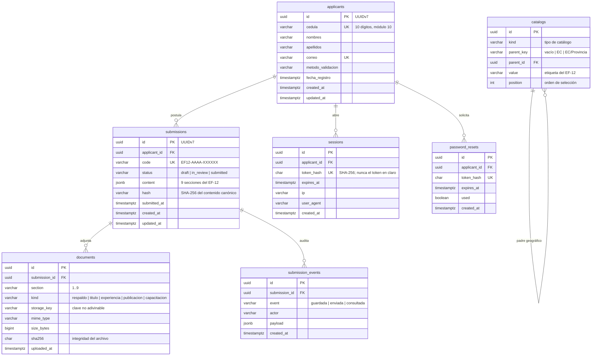

# Modelo de datos

**Sistema de Registro y Postulación al Directorio del BIESS**
Documento de base de datos v1.0

| Campo | Valor |
|---|---|
| Documento | SCHEMA v1.0 |
| Motor | PostgreSQL 18 |
| Acceso | `pgx` v5 (pool + transacciones) |
| Identificadores | UUIDv7 (RFC 9562), generados por la aplicación y con `DEFAULT uuidv7()` en la base |
| Migraciones | `goose` v3, embebidas en el binario |
| Acceso tipado | `sqlc` v1.31 (SQL → Go) |
| TRD asociado | [`../trd/TRD.md`](../trd/TRD.md) |

---

## 1. Panorama



**Estado de cada tabla**

| Tabla | Estado | Nota |
|---|---|---|
| `applicants` | Implementada | Falta `password_hash` (criterio EF-11) |
| `submissions` | Implementada | Referencia completa |
| `documents` | Implementada | Migración `00004_documents.sql`: sección, registro, tamaño, SHA-256 y clave privada |
| `document_deletions` | Implementada | Cola transaccional de bajas, incluidas cascadas de borradores |
| `sessions` | Planificada | Requiere el contexto `identity` |
| `password_resets` | Planificada | Requiere el contexto `identity` |
| `catalogs` | Implementada | Migración `00008_catalogs.sql`, geografía y opciones EF-12 con padres UUID |
| `submission_events` | Planificada | Auditoría append-only |

Las tablas planificadas **no** están en el esquema actual: se crean con una
migración goose nueva cuando su contexto se implemente. El diagrama muestra
el destino; el DDL vigente está en la sección 2.

---

## 2. DDL vigente

Fuente: `apps/backend/sql/migrations/00001_init.sql`, más la migración
`00002_uuidv7.sql`, que añade los valores por defecto `uuidv7()` y el índice
con el identificador.

```sql
-- +goose Up
CREATE TABLE applicants (
    id                UUID PRIMARY KEY,
    cedula            VARCHAR(10)  NOT NULL UNIQUE,
    nombres           VARCHAR(120) NOT NULL,
    apellidos         VARCHAR(120) NOT NULL,
    correo            VARCHAR(255) NOT NULL UNIQUE,
    metodo_validacion VARCHAR(32)  NOT NULL DEFAULT 'fecha_expedicion',
    fecha_registro    TIMESTAMPTZ  NOT NULL DEFAULT now(),
    created_at        TIMESTAMPTZ  NOT NULL DEFAULT now(),
    updated_at        TIMESTAMPTZ  NOT NULL DEFAULT now()
);

CREATE TABLE submissions (
    id           UUID PRIMARY KEY,
    applicant_id UUID        NOT NULL REFERENCES applicants (id) ON DELETE CASCADE,
    code         VARCHAR(32) NOT NULL UNIQUE,
    status       VARCHAR(16) NOT NULL DEFAULT 'draft',
    content      JSONB       NOT NULL DEFAULT '{}'::jsonb,
    hash         VARCHAR(64),
    submitted_at TIMESTAMPTZ,
    created_at   TIMESTAMPTZ NOT NULL DEFAULT now(),
    updated_at   TIMESTAMPTZ NOT NULL DEFAULT now(),
    CONSTRAINT submissions_status_check CHECK (status IN ('draft', 'in_review', 'submitted'))
);

CREATE INDEX submissions_applicant_idx ON submissions (applicant_id, updated_at DESC);

-- +goose Down
DROP INDEX IF EXISTS submissions_applicant_idx;
DROP TABLE IF EXISTS submissions;
DROP TABLE IF EXISTS applicants;
```

### 2.1 Notas de diseño

| Decisión | Motivo |
|---|---|
| `id UUID` **v7** generado en la aplicación | El identificador se conoce antes de insertar (el dominio no depende de la base) y, al estar ordenado en el tiempo, no fragmenta el índice del PRIMARY KEY. Ver [ADR-007](../decisions/ADR-007-postgresql-18-y-uuidv7.md) |
| `DEFAULT uuidv7()` en la base | Red de seguridad para los caminos de inserción que no fijan el identificador: semillas, importaciones o SQL manual |
| `content JSONB` | Las 9 secciones del EF-12 evolucionan con el RF; no se fuerza una migración por cada campo nuevo |
| Columnas propias para lo que se consulta | `code`, `status`, `applicant_id` y `hash` tienen índice y filtro propios |
| `CHECK` sobre `status` | El conjunto de estados es un invariante del dominio y queda garantizado en la base, no solo en Go |
| `ON DELETE CASCADE` | No existen postulaciones huérfanas: si se elimina el postulante, se va su postulación |
| `hash VARCHAR(64)` | SHA-256 en hexadecimal ocupa exactamente 64 caracteres |
| `submissions_applicant_idx` sobre `(applicant_id, updated_at DESC, id DESC)` | Cubre el listado por postulante y **el desempate de la paginación por cursor**: con UUIDv7 el `id` ordena por fecha de creación, así que la clave completa se resuelve dentro del índice |

### 2.2 Identificadores UUIDv7

Desde la migración `00002_uuidv7.sql`, las columnas `id` usan UUIDv7 (RFC 9562):
los 48 bits iniciales son una marca de tiempo en milisegundos y el resto es
aleatorio.

```sql
-- El motor genera el mismo formato que la aplicación
SELECT uuidv7();

-- La marca de tiempo de creación se recupera del identificador
SELECT uuid_extract_timestamp(id) FROM submissions;
```

Tres propiedades que el proyecto usa a propósito:

| Propiedad | Para qué |
|---|---|
| Orden por fecha de creación | El índice del PRIMARY KEY no se fragmenta con inserciones nuevas |
| Marca de tiempo recuperable | Diagnóstico y particionado futuro sin columnas adicionales |
| Desempate coherente con el cursor | La clave `(updated_at, id)` tiene un orden real, no arbitrario |

> La migración `00002` usa `uuidv7()`, que **solo existe en PostgreSQL 18**.
> Actualizar el motor es un paso previo a correr las migraciones; el
> procedimiento está en
> [`../deployment/PRODUCTION_DEPLOYMENT.md`](../deployment/PRODUCTION_DEPLOYMENT.md).

---

## 3. Catálogo geográfico (semilla)

El RF exige la cascada **País → Provincia → Cantón** con las **24 provincias**
del Ecuador. T7 persiste los países de `submission/definition.json`, la geografía
de `submission/geography.go` (idéntica a `apps/frontend/src/data/ecuadorGeo.ts`) y
las opciones de dominio en la tabla `catalogs`, mediante `00008_catalogs.sql`.
La tabla relaciona provincias con Ecuador y cantones con su provincia mediante
`parent_id` UUID; `parent_key` permite consultas indexadas por tipo y padre.
Una clave única `(kind, parent_key, value)` hace idempotente la semilla y evita
mezclar cantones de igual nombre pertenecientes a provincias distintas.

Entregables versionados:

- `apps/backend/sql/migrations/00008_catalogs.sql`: DDL y semilla goose.
- `apps/backend/sql/seeds/catalogs.sql`: DDL y semilla SQL autónoma, transaccional e
  idempotente, lista para una base vacía de PostgreSQL 18 sin tablas de postulantes.
- `apps/backend/sql/queries/schema.sql`: esquema completo que consume SQLC.

Desde `apps/backend/`, `make catalog-seed` (o `go run ./cmd/catalog-seed`) regenera
la migración y el SQL autónomo desde las fuentes EF-12. Después se regenera
`schema.sql` y SQLC. Una migración ya desplegada no se reescribe para cambiar datos:
se añade otra migración y se invalidan las claves `catalog:*` o se espera su TTL
de 24 horas. Los catálogos no tienen edición pública.

### 3.1 Provincias y cantones (24 provincias · 221 cantones)

| # | Provincia | Cantones | Cant. |
|---|---|---|---:|
| 1 | Azuay | Cuenca, Chordeleg, El Pan, Girón, Guachapala, Gualaceo, Nabón, Oña, Paute, Ponce Enríquez, Pucará, San Fernando, Santa Isabel, Sevilla de Oro, Sigsig | 15 |
| 2 | Bolívar | Guaranda, Caluma, Chillanes, Chimbo, Echeandía, Las Naves, San Miguel | 7 |
| 3 | Cañar | Azogues, Biblián, Cañar, Déleg, El Tambo, La Troncal, Suscal | 7 |
| 4 | Carchi | Tulcán, Bolívar, Espejo, Mira, Montúfar, San Pedro de Huaca | 6 |
| 5 | Chimborazo | Riobamba, Alausi, Chambo, Chunchi, Colta, Cumandá, Guamote, Guano, Pallatanga, Penipe | 10 |
| 6 | Cotopaxi | Latacunga, La Maná, Pangua, Pujilí, Salcedo, Saquisilí, Sigchos | 7 |
| 7 | El Oro | Machala, Arenillas, Atahualpa, Balsas, Chilla, El Guabo, Huaquillas, Las Lajas, Marcabelí, Pasaje, Piñas, Portovelo, Santa Rosa, Zaruma | 14 |
| 8 | Esmeraldas | Esmeraldas, Atacames, Eloy Alfaro, Muisne, Quinindé, Rioverde, San Lorenzo | 7 |
| 9 | Galápagos | San Cristóbal, Isabela, Santa Cruz | 3 |
| 10 | Guayas | Guayaquil, Alfredo Baquerizo Moreno (Juján), Balao, Balzar, Colimes, Daule, Durán, El Empalme, El Triunfo, General Antonio Elizalde (Bucay), Isidro Ayora, Lomas de Sargentillo, Marcelino Maridueña, Milagro, Naranjal, Naranjito, Nobol, Palestina, Pedro Carbo, Playas, Salitre, Samborondón, Santa Lucía, Simón Bolívar, Yaguachi | 25 |
| 11 | Imbabura | Ibarra, Antonio Ante, Cotacachi, Otavalo, Pimampiro, San Miguel de Urcuquí | 6 |
| 12 | Loja | Loja, Calvas, Catamayo, Celica, Chaguarpamba, Espíndola, Gonzanamá, Macará, Olmedo, Paltas, Pindal, Puyango, Quilanga, Saraguro, Sozoranga, Zapotillo | 16 |
| 13 | Los Ríos | Babahoyo, Baba, Buena Fe, Mocache, Montalvo, Palenque, Puebloviejo, Quevedo, Quinsaloma, Urdaneta, Valencia, Ventanas, Vinces | 13 |
| 14 | Manabí | Portoviejo, Bolívar, Chone, El Carmen, Flavio Alfaro, Jama, Jaramijó, Jipijapa, Junín, Manta, Montecristi, Olmedo, Paján, Pedernales, Pichincha, Puerto López, Rocafuerte, San Vicente, Santa Ana, Sucre (Bahía), Tosagua, Veinticuatro de Mayo | 22 |
| 15 | Morona Santiago | Morona (Macas), Gualaquiza, Huamboya, Limón Indanza, Logroño, Pablo Sexto, Palora, San Juan Bosco, Santiago, Sucúa, Taisha, Tiwintza | 12 |
| 16 | Napo | Tena, Archidona, Carlos Julio Arosemena Tola, El Chaco, Quijos (Baeza) | 5 |
| 17 | Orellana | Francisco de Orellana (El Coca), Aguarico, La Joya de los Sachas, Loreto | 4 |
| 18 | Pastaza | Pastaza (Puyo), Arajuno, Mera, Santa Clara | 4 |
| 19 | Pichincha | Quito, Cayambe, Mejía (Machachi), Pedro Moncayo (Tabacundo), Pedro Vicente Maldonado, Puerto Quito, Rumiñahui (Sangolquí), San Miguel de Los Bancos | 8 |
| 20 | Santa Elena | Santa Elena, La Libertad, Salinas | 3 |
| 21 | Santo Domingo de los Tsáchilas | Santo Domingo, La Concordia | 2 |
| 22 | Sucumbíos | Lago Agrio (Nueva Loja), Cascales, Cuyabeno, Gonzalo Pizarro, Putumayo, Shushufindi, Sucumbíos | 7 |
| 23 | Tungurahua | Ambato, Baños de Agua Santa, Cevallos, Mocha, Patate, Pelileo, Píllaro, Quero, Tisaleo | 9 |
| 24 | Zamora Chinchipe | Zamora, Centinela del Cóndor, Chinchipe, El Pangui, Nangaritza, Palanda, Paquisha, Yacuambi, Yantzaza | 9 |

### 3.2 Países del RF

Se persisten los **194 países enumerados en EF-12 1.2.1**, en el mismo orden y con
sus nombres del RF. No se utiliza la antigua muestra local de 18 ni `Otro país`.
La cabecera de página de la extracción se quitó del nombre `Bután`, sin cambiar
`docs/requerimiento.txt`. Un test contrasta la lista semilla con el RF limpio.

Si el país no es Ecuador, provincia y cantón se ingresan manualmente. La API
devuelve listas geográficas vacías para esos países; no inventa sus divisiones.
El contrato conserva arrays de nombres; `EC` es un alias HTTP de `Ecuador`.

### 3.3 Diferencias entre los cantones del RF y el catálogo de 221 entradas

Se conserva el catálogo del proyecto que ya validan los formularios, más amplio
que la lista parcial de EF-12 1.2.3. Los siguientes cantones no están enumerados
en esa lista parcial y se mantienen en la semilla:

| Provincia | Entradas conservadas además de la lista del RF |
|---|---|
| Azuay | El Pan, Guachapala, Nabón, Oña, Paute, San Fernando, Sevilla de Oro |
| Chimborazo | Chambo |
| Guayas | Alfredo Baquerizo Moreno (Juján), Balao, General Antonio Elizalde (Bucay), Marcelino Maridueña, Palestina, Santa Lucía |
| Loja | Olmedo, Pindal, Quilanga |
| Los Ríos | Quinsaloma |
| Morona Santiago | Huamboya, Logroño, Pablo Sexto |
| Santa Elena | Salinas |

También se conservan las etiquetas compatibles existentes: `Ponce Enríquez`
frente a `Camilo Ponce Enríquez`, `Sigsig` frente a `Sígsig`, `Alausi` frente a
`Alausí`, `Veinticuatro de Mayo` frente a `24 de Mayo` y nombres con cabeceras
entre paréntesis como `Sucre (Bahía)`, `Morona (Macas)`, `Quijos (Baeza)`,
`Francisco de Orellana (El Coca)`, `Pastaza (Puyo)`, `Lago Agrio (Nueva Loja)`,
`Mejía (Machachi)`, `Pedro Moncayo (Tabacundo)` y `Rumiñahui (Sangolquí)`.
Estos son los valores de captura del proyecto; T7 no los renombra ni altera
snapshots enviados. La cifra de 221 describe este catálogo versionado.

### 3.4 Catálogos de dominio

Además de geografía se persisten **47 opciones en doce grupos**: géneros, estados
civiles, respuestas Sí/No, parentescos, instituciones IESS/BIESS, sectores,
niveles, tipos de institución, áreas, tipos de experiencia, publicaciones y eventos.
Se generan desde `submission/definition.json` y se publican por
`GET /api/v1/catalogs/options/{name}`, con el mismo TTL y fallback PostgreSQL.

---

## 4. Paginación en base de datos

El contexto `submission` usa las dos estrategias del kernel compartido.

### 4.1 Offset — listados acotados

```sql
-- name: ListSubmissionsByApplicant :many
SELECT * FROM submissions WHERE applicant_id = $1 ORDER BY updated_at DESC LIMIT $2 OFFSET $3;

-- name: CountSubmissionsByApplicant :one
SELECT count(*) FROM submissions WHERE applicant_id = $1;
```

### 4.2 Cursor (keyset) — listados grandes

La clave de orden es `(updated_at DESC, id DESC)`. El `id` desempata las
filas con la misma fecha, de modo que la paginación nunca omite ni repite
registros.

```sql
-- name: ListSubmissionsByApplicantCursorFirst :many
SELECT * FROM submissions
WHERE applicant_id = $1
ORDER BY updated_at DESC, id DESC
LIMIT $2;

-- name: ListSubmissionsByApplicantCursor :many
SELECT * FROM submissions
WHERE applicant_id = $1
  AND (updated_at < $2 OR (updated_at = $2 AND id < $3))
ORDER BY updated_at DESC, id DESC
LIMIT $4;
```

El cursor travels codificado en base64url con los dos valores de la clave
(`updated_at|id`). El cliente lo reenvía tal cual: **no lo interpreta**.

---

## 5. Transacciones

El guardado de una postulación con sus documentos y sus eventos de auditoría
debe ser atómico. El gestor de transacciones vive en
`apps/backend/internal/platform/db/db.go` y expone `WithinTx`:

```go
err := txManager.WithinTx(ctx, func(tx pgx.Tx) error {
    if err := repo.Create(ctx, tx, submission); err != nil {
        return err          // cualquier error dispara ROLLBACK
    }
    if err := repo.SaveDocuments(ctx, tx, documents); err != nil {
        return err
    }
    return repo.SaveEvents(ctx, tx, events)
})
```

- `WithinTx` abre la transacción, ejecuta la función, hace `COMMIT` si
  devuelve `nil` y `ROLLBACK` ante error o panic.
- El repositorio recibe el `pgx.Tx` como parámetro: la misma interfaz sirve
  para una operación suelta (pool) o dentro de una transacción.
- `mapError` traduce las violaciones de restricciones a errores de dominio:
  `23505` → `ErrDuplicateCode`, `23503` → `ErrInvalidApplicant`.

---

## 6. Integridad del contenido

El contenido del formulario se **canoniza** antes de persistirse: se
deserializa a un mapa y se vuelve a serializar, de modo que `encoding/json`
ordena las claves. Dos formularios idénticos producen **exactamente el mismo
JSON**, sin importar el orden en que el cliente envíe las secciones.

```go
canonical, err := submission.CanonicalContent(content)  // claves ordenadas
hash := submission.HashContent(canonical)                // SHA-256 hex
```

De ahí se derivan dos garantías:

1. El hash es **estable**: el mismo formulario produce la misma huella.
2. El hash es **verificable**: en cualquier momento se recalcula sobre el
   contenido almacenado y se compara con `submissions.hash`.

---

## 7. Migraciones

```bash
cd apps/backend

make db-migrate     # aplica las migraciones pendientes
make db-status      # muestra el estado
make db-down        # revierte la última migración aplicada
make db-reset       # recrea el esquema (DESTRUCTIVO)
make db-schema      # regenera sql/queries/schema.sql desde las migraciones
```

Reglas:

1. Una migración = un cambio lógico. El nombre es secuencial:
   `00003_add_password_hash.sql`.
2. Toda migración lleva su bloque `-- +goose Up` y `-- +goose Down`.
3. `schema.sql` se **regenera**, no se edita a mano: es la entrada de `sqlc`.
4. Las migraciones viajan **embebidas en el binario** (`sql/migrations/` con
   `embed.FS`), así que en producción no hace falta el CLI de goose.
5. Los cambios de datos que necesita el seed de catálogos van en una
   migración `INSERT ... ON CONFLICT DO NOTHING`, de modo que sea idempotente.
6. **Una migración puede requerir una versión mínima del motor.** La
   `00002_uuidv7.sql` usa `uuidv7()`, que existe desde PostgreSQL 18: aplicar
   las migraciones sobre un motor anterior falla y hay que actualizarlo antes.

### 7.1 Migraciones vigentes

| Migración | Qué hace |
|---|---|
| `00001_init.sql` | Crea `applicants` y `submissions`, con su índice y su restricción de estado |
| `00002_uuidv7.sql` | Pone `DEFAULT uuidv7()` en los identificadores y recompone el índice con `id DESC` |

### 7.2 El volumen de PostgreSQL 18

Desde la versión 18, las imágenes Docker de PostgreSQL guardan los datos en
un directorio por versión mayor:

```text
/var/lib/postgresql/
└── 18/
    └── docker/      # PGDATA
```

Por eso el volumen se monta en **`/var/lib/postgresql`** y no en
`/var/lib/postgresql/data`. Un directorio de datos de PostgreSQL 17 **no** lo
abre un PostgreSQL 18: la imagen se niega a arrancar y avisa de que parece un
intento de actualizar la imagen sin actualizar la base. El procedimiento de
actualización está en
[`../deployment/PRODUCTION_DEPLOYMENT.md`](../deployment/PRODUCTION_DEPLOYMENT.md).

---

## 8. Consultas y código generado

| Artefacto | Ruta | Nota |
|---|---|---|
| Migraciones | `apps/backend/sql/migrations/` | Fuente de verdad del esquema |
| Esquema para sqlc | `apps/backend/sql/queries/schema.sql` | Generado con `make db-schema` |
| Queries | `apps/backend/sql/queries/submissions.sql` | Escritas a mano |
| Código generado | `apps/backend/internal/platform/sqlcgen/` | **No editar**: se regenera |

```bash
make sqlc-generate   # regenera internal/platform/sqlcgen
```

El CI verifica que el código generado está al día: si alguien edita
`sqlcgen/` a mano, el pipeline falla.

---

## 9. Copias de seguridad

En producción (fuera del alcance del parcial, pero previsto):

```bash
# Copia lógica
pg_dump --format=custom --file=biess-$(date +%F).dump "$DATABASE_URL"

# Restauración
pg_restore --clean --if-exists --dbname="$DATABASE_URL" biess-2026-04-01.dump
```

Los documentos PDF **no** están en PostgreSQL: viven en el bucket de objetos.
La base solo guarda la clave, el tamaño, el MIME y el SHA-256, así que la
copia de la base es suficiente para reconstruir el índice, pero no los
archivos.

---

**Ver también**: [`../trd/TRD.md`](../trd/TRD.md) ·
[`../architecture/ARQUITECTURA.md`](../architecture/ARQUITECTURA.md) ·
[`../api-contracts/API_CONTRACT.md`](../api-contracts/API_CONTRACT.md)

### Documentos y cuota (T4)

`00004_documents.sql` crea `documents` con una restricción única por
`(submission_id, section, record_id)`, límites de bytes por sección, MIME PDF
y SHA-256 hexadecimal. La clave de almacenamiento también es única.
La cuota de 50 MiB se comprueba sumando todas las postulaciones de la cuenta
bajo `SELECT applicants ... FOR UPDATE`; luego se bloquea la postulación.
La mutación confirma juntos el documento y la referencia JSON del formulario.

El verificador del envío lee documentos con la misma conexión transaccional,
mediante el contexto compartido por adaptadores. Las bajas activan un trigger
que inserta la clave en `document_deletions`; el proceso de limpieza elimina
el objeto de forma idempotente y luego retira la tarea. El rollback no deja
una tarea de borrado para un documento que siga vigente. Las pruebas reales
se habilitan con `DOCUMENT_TEST_DATABASE_URL` contra PostgreSQL 18.

### Método de validación de identidad vigente

Las cuentas nuevas creadas por el servicio usan `metodo_validacion = otp_correo`.
El `DEFAULT fecha_expedicion` visible en el DDL histórico no implica que exista
una validación con Registro Civil: el servicio asigna el método explícitamente.
No se almacenan fecha de expedición ni código dactilar como requisitos del flujo
vigente. Ver ADR-008 y la consolidación del desafío OTP en T16.
