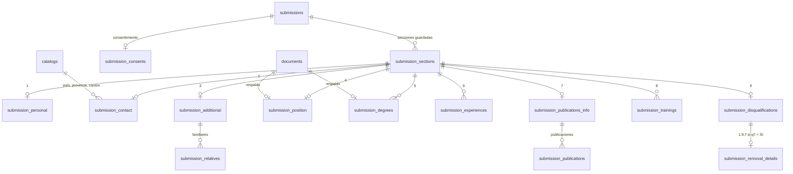

# ADR-010 — Formulario de postulación normalizado con snapshot sellado

| Campo | Valor |
|---|---|
| ADR | 010 |
| Estado | **Aceptada** |
| Fecha | 2026-11-04 |
| Ámbito | Backend (persistencia del formulario de postulación) |
| Modifica | [ADR-003](ADR-003-postgres-sqlc-goose.md), consecuencia «`jsonb` para el contenido del formulario» |
| Referencia | [`../database/SCHEMA.md`](../database/SCHEMA.md) §10 |

---

## Contexto

Hasta la migración `00022`, las nueve secciones del formulario de postulación
vivían en una sola columna `submissions.content jsonb`. La decisión venía de
ADR-003: el RF evoluciona y un documento JSON evita una migración por cada
campo nuevo. Tenía tres costos:

1. **No era un modelo normalizado.** Familiares, títulos, experiencias,
   publicaciones y capacitaciones no tenían tablas propias, y la base no podía
   garantizar nada sobre ellos: ni las opciones del RF, ni la cascada país →
   provincia → cantón, ni que un PDF perteneciera al registro que respalda. Toda
   la integridad dependía del código Go. El criterio 2 de la rúbrica pide
   explícitamente «modelado normalizado y transacciones para inserciones
   multi-tabla en el guardado de la postulación».
2. **Los datos de negocio se consultaban dentro del documento.** El sector se
   extraía con `content->'seccion4'->>'sector'` en un índice, en dos triggers y
   en las consultas de revisión y resultados.
3. **Había datos repetidos.** La cédula y el correo de la cuenta se copiaban en
   cada formulario.

A la vez, el JSON tenía una virtud que había que conservar: el **hash del
envío** se calcula sobre el JSON canónico del formulario sellado. Un
expediente enviado debe poder verificarse siempre, aunque el esquema cambie
después.

## Decisión

**Tablas normalizadas mientras el formulario se edita; snapshot JSON inmutable
desde que se sella.**

| Estado de la postulación | Fuente del formulario | `submissions.content` |
|---|---|---|
| `draft`, `in_review` | Tablas normalizadas | `NULL` |
| `submitted`, `closed` | `content` (snapshot) | JSON canónico congelado; el envío además lleva `hash` |

Al sellar, las tablas se escriben en la misma transacción que el snapshot y
quedan congeladas por trigger: siguen disponibles para consultas, pero el
documento de valor legal es el snapshot.

### Modelo

`submissions → submission_sections → datos de la sección → registros`.

### Lo que garantiza la base, no solo Go

- **Ningún dato sin su sección.** Cada tabla de datos tiene una clave foránea
  `(submission_id, section)` hacia `submission_sections`, con la sección como
  columna generada constante. Quitar una sección borra sus datos en cascada.
- **Cascada geográfica del RF.** El país siempre es un id de `catalogs`. Para
  Ecuador, la provincia y el cantón también son ids, y las claves compuestas
  `(provincia, país)` y `(cantón, provincia)` → `catalogs(id, parent_id)`
  impiden una provincia de otro país o un cantón de otra provincia. Para otro
  país, provincia y ciudad se escriben a mano; nunca id y texto a la vez.
- **Cada PDF pertenece a su registro.** `(document_id, submission_id, section,
  record_key)` → `documents`, diferida hasta el `COMMIT` porque el servicio de
  documentos borra el PDF antes de soltar la referencia.
- **1.9.7 solo con «Sí».** El detalle de remoción referencia
  `(submission_id, q7 = 'Sí')`.
- **Opciones cerradas del RF** como `CHECK`, iguales a `definition.json`; una
  prueba lee `pg_constraint` y falla si divergen.
- **Expediente inmutable.** Las tablas rechazan escrituras de expedientes
  enviados o cerrados y fuera de la ventana de la convocatoria.
- **Snapshot coherente.** Todo expediente enviado o cerrado tiene `content`, y
  su `sector` no puede discrepar del snapshot.

### Lo que no se guarda (3FN)

| Dato | Se toma de |
|---|---|
| Cédula y correo principal | `applicants` (el servicio ya obligaba a que coincidieran) |
| Duración de la experiencia | Se calcula al leer; queda congelada solo en el snapshot |
| Nombre, tamaño, SHA-256 y fecha del PDF | `documents` |
| `verificadoRegistroCivil` | Siempre `false` ([ADR-008](ADR-008-registro-y-recuperacion-con-otp.md)) |
| Versión y textos del consentimiento | Constantes del RF en el código |
| Nombres de país, provincia y cantón del catálogo | `catalogs` |

### Reglas

1. **Ningún `CHECK` es más estricto que la validación del borrador en Go.** Un
   borrador incompleto que Go acepta, la base también lo acepta: un texto
   pendiente es `''` y una fecha pendiente es `NULL`. Lo que exige el envío
   completo sigue en Go.
2. **El dominio no cambia.** La traducción entre el formulario y las tablas vive
   en el adaptador (`internal/submission/postgres`), como pide
   [ADR-002](ADR-002-bounded-contexts-y-hexagonal.md). El contrato HTTP y el
   frontend no cambian.
3. **Guardar una sección es una transacción multi-tabla.** Se reescriben solo
   las secciones que cambiaron, comparadas contra las tablas; luego la cabecera
   y el evento de auditoría, todo en un `WithinTx`.
4. **El sello escribe las tablas antes de cambiar el estado**, mientras la fila
   todavía es un borrador.
5. Un campo nuevo del formulario exige una migración: es el costo aceptado de
   normalizar.

### Migración en cinco pasos (expansión y contracción)

| Migración | Qué hace |
|---|---|
| `00023_submission_sector` | `sector` como columna propia (generada desde `content`); índice y triggers dejan de leer el JSON |
| `00024_submission_form_tables` | Las catorce tablas, sus `CHECK`, claves y triggers |
| (código) | El adaptador escribe las tablas junto con `content` y las compara en las pruebas |
| `00025_submission_form_backfill` (Go) | Rellena las tablas desde `content`; cada borrador se verifica byte a byte o la migración falla |
| `00026_submission_content_snapshot` | `sector` deja de ser generada; `content` solo para expedientes sellados o cerrados |
| `00027_submission_draft_content` (Go) | Repite el relleno verificado y vacía el `content` de los borradores; la reversión lo reconstruye |

Las migraciones Go no usan la transacción de goose: toman la conexión pgx
nativa y abren la suya, para reutilizar el adaptador. Siguen siendo atómicas.
`submissions` no se modifica durante el relleno: el hash y el snapshot de los
expedientes enviados quedan intactos, y lo verifican las pruebas.

## Alternativas consideradas

### Mantener `content jsonb` y defenderlo

- ✅ Sin trabajo.
- ❌ No cumple «normalizado» y deja toda la integridad en Go.

### Normalizar todo y eliminar el JSON

- ✅ Un único modelo.
- ❌ El hash del envío dejaría de ser verificable si el esquema cambia: no se
  podría reconstruir el documento exacto que se selló.
- ❌ Obliga a reescribir los seis contextos que leen expedientes enviados
  (revisión, resultados, méritos, evaluación, examen y privacidad).

### Tablas normalizadas con snapshot sellado (elegida)

- ✅ Modelo normalizado con integridad en la base.
- ✅ El snapshot conserva el valor legal del envío.
- ✅ Los contextos que leen expedientes enviados no cambian.

### Opciones del RF como claves foráneas a `catalogs`

- ✅ Una sola fuente para las listas.
- ❌ Cada campo necesitaría dos columnas constantes para la clave compuesta. Se
  usa `CHECK` y una prueba de paridad con `definition.json`; las claves
  foráneas a `catalogs` quedan para la geografía, que es la cascada del RF.

## Consecuencias

### Positivas

- La base rechaza por sí misma datos inválidos, huérfanos o incoherentes.
- Revisión y resultados filtran por una columna indexada.
- Guardar una sección es una transacción multi-tabla real, y el sello también.

### Negativas

- Leer un borrador cuesta unas quince consultas en vez de una. Solo afecta al
  postulante, que tiene pocas postulaciones; los listados del analista leen
  snapshots.
- Cada campo nuevo del formulario requiere migración y ajustar el mapeo.
- Las migraciones `00025` y `00027` reutilizan el adaptador vigente: si el mapeo
  cambia, una base nueva las ejecutaría con el código nuevo. Se acepta porque una
  base nueva no tiene datos heredados que rellenar.
- El diario de estados ya no ve el contenido del borrador. Para que cada
  guardado siga siendo visible, proyecta además la fecha de modificación y el
  sector de `submissions`, sin datos personales.

## Cómo se justifica en la sustentación

> "Mientras el postulante llena el formulario, cada sección vive en su tabla:
> una por sección y una por registro repetible, con claves foráneas al catálogo
> geográfico y a los PDF, y con las opciones del RF como restricciones. Guardar
> una sección es una transacción que escribe la sección, la cabecera y el
> evento de auditoría; si algo falla, no queda nada. Al enviar, el formulario
> se congela en un JSON canónico con su hash: ese documento no cambia aunque
> mañana cambie el esquema, y por eso se puede verificar siempre. Una
> postulación que se edita está normalizada; una que se envió es un documento
> sellado."

Preguntas previsibles:

- **¿Por qué conservar JSON si ya está normalizado?** Porque el hash legal se
  calcula sobre un documento. Si se rearmara desde las tablas, un cambio de
  esquema alteraría el documento y el hash dejaría de coincidir.
- **¿Dónde está la transacción multi-tabla?** En `Repository.update`
  (`internal/submission/postgres`): escribe las tablas de la sección, la
  cabecera y el evento dentro del `WithinTx` de `Mutate`, bajo `SELECT … FOR
  UPDATE`.
- **¿Qué impide un cantón de otra provincia?** La clave compuesta `(city_id,
  province_id)` → `catalogs(id, parent_id)`, además de la validación en Go.

## Referencias

- Migraciones: `apps/backend/sql/migrations/00023` a `00027`
- Adaptador: `apps/backend/internal/submission/postgres/` (`mapping.go`,
  `form_store.go`, `backfill.go`)
- Consultas: `apps/backend/sql/queries/submission_form.sql`
- Pruebas: `mapping_test.go`, `form_tables_integration_test.go`,
  `shadow_integration_test.go`, `backfill_integration_test.go`,
  `snapshot_integration_test.go`, `sector_integration_test.go`
- Rúbrica, criterio 2 (8 pts): modelado normalizado y transacciones multi-tabla.
