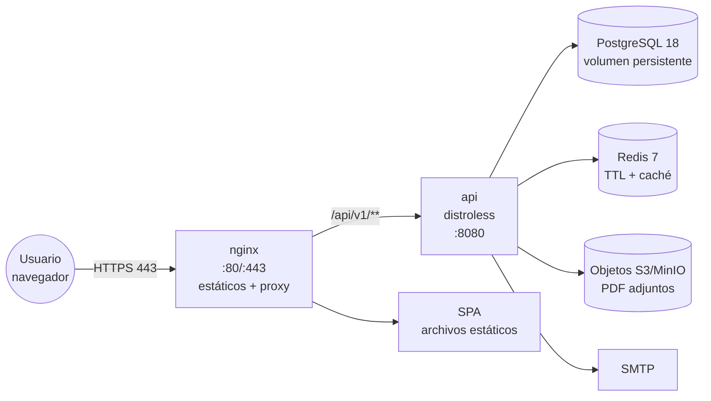

# Despliegue en producción

**Sistema de Registro y Postulación al Directorio del BIESS**
Guía del entorno de producción

| Campo | Valor |
|---|---|
| Documento | PRODUCTION_DEPLOYMENT v1.0 |
| Compose | `deploy/compose.yaml` |
| Reverse proxy | `deploy/nginx.conf` |
| Variables | `deploy/.env` (**nunca versionado**) |

---

## 1. Topología



**Un solo origen público**: nginx sirve la SPA y reenvía `/api` a la API. De
ahí se derivan tres propiedades:

- No hay CORS: el navegador nunca hace una petición a otro origen.
- Las cookies de sesión son de primer nivel: `SameSite=Lax` funciona sin
  excepciones y `Secure` es viable.
- El certificado TLS vive en un único lugar.

> **Estado**: Redis y el almacenamiento de objetos están **pendientes de
> implementación** (ver [`../tasks/backend-tasks.md`](../tasks/backend-tasks.md)).
> El compose de producción documenta el diseño final; hoy el servicio `api`
> no abre conexión con ninguno de los dos.

---

## 2. Requisitos del servidor

| Recurso | Mínimo | Recomendado |
|---|---|---|
| CPU | 2 vCPU | 4 vCPU |
| RAM | 2 GB | 4 GB |
| Disco | 20 GB | 50 GB + backups |
| SO | Linux con Docker Engine 24+ y Compose v2 | — |

Puertos que deben quedar **cerrados** al exterior, salvo el 80/443:

| Puerto | Servicio | Exposición |
|---|---|---|
| 80 / 443 | nginx | Público (con TLS) |
| 8080 | API Go | Solo red interna |
| 5432 | PostgreSQL | Solo red interna |
| 6379 | Redis | Solo red interna |
| 1025 | SMTP de pruebas | **Cerrado** (no existe en producción) |

---

## 3. Preparación

### 3.1 Variables de entorno

```bash
cp deploy/.env.example deploy/.env
chmod 600 deploy/.env
```

`deploy/.env` está en `.gitignore` y **nunca** se versiona. Contiene:

| Variable | Obligatoria | Descripción |
|---|---|---|
| `POSTGRES_USER` | Sí | Usuario de PostgreSQL |
| `POSTGRES_PASSWORD` | Sí | Contraseña de PostgreSQL |
| `POSTGRES_DB` | No (`biess`) | Base de datos |
| `DATABASE_URL` | Sí | Cadena de conexión que usa la API |
| `CORS_ALLOWED_ORIGINS` | No | Origen público; vacío = denegar todo |
| `MAX_REQUEST_BODY_BYTES` | No (`10485760`) | Máximo del cuerpo (10 MiB) |
| `LOG_LEVEL` | No (`info`) | Nivel de log |
| `SMTP_HOST` / `SMTP_PORT` | No | Servidor de correo |
| `SMTP_USER` / `SMTP_PASSWORD` | No | Credenciales de correo |
| `SMTP_FROM` | No | Remitente |
| `SMTP_TLS` | No (`true`) | STARTTLS |

> `DATABASE_URL` y `POSTGRES_PASSWORD` son obligatorias: el compose falla
> rápido con un mensaje claro si no están definidas.

### 3.2 Generar una contraseña de base de datos

```bash
openssl rand -base64 32
```

### 3.3 Reconstruir el esquema

```bash
# Con las migraciones embebidas en el binario
docker compose -f deploy/compose.yaml run --rm api /app/migrate
```

Las migraciones viajan dentro de la imagen: **no hace falta** el CLI de goose
en el servidor.

---

## 4. Primer despliegue

```bash
cd deploy

# Construir las imágenes
docker compose build

# Levantar el stack
docker compose up -d

# Verificar el estado
docker compose ps
curl -s http://localhost/healthz
curl -s http://localhost/api/v1/...   # según el endpoint
```

Los servicios declaran `depends_on` con `condition: service_healthy`, así que
la API no arranca hasta que PostgreSQL responde, y nginx no sirve tráfico
hasta que la API está sana.

---

## 5. TLS

El compose expone nginx en el puerto 80. Para terminar TLS hay dos vías.

### 5.1 Terminal Let's Encrypt con Certbot (recomendado)

```bash
# 1. Certbot standalone
docker run --rm \
  -p 80:80 \
  -v /etc/letsencrypt:/etc/letsencrypt \
  certbot/certbot certonly --standalone \
  -d concurso.biess.gob.ec \
  --agree-tos -m admin@biess.gob.ec --no-eff-email

# 2. Montar los certificados en el servicio nginx
```

Añadir al servicio `frontend` de `deploy/compose.yaml`:

```yaml
    volumes:
      - /etc/letsencrypt:/etc/letsencrypt:ro
```

Y en `deploy/nginx.conf`, añadir el bloque `server` de HTTPS:

```nginx
server {
    listen 443 ssl http2;
    server_name concurso.biess.gob.ec;

    ssl_certificate     /etc/letsencrypt/live/concurso.biess.gob.ec/fullchain.pem;
    ssl_certificate_key /etc/letsencrypt/live/concurso.biess.gob.ec/privkey.pem;

    ssl_protocols       TLSv1.2 TLSv1.3;
    ssl_prefer_server_ciphers off;
    ssl_session_cache   shared:SSL:10m;

    include /etc/nginx/conf.d/default.conf;   # el bloque HTTP actual
}
```

> `nginx.conf` se **copia dentro de la imagen** en el Dockerfile. Si se
> modifica, hay que reconstruir: `docker compose build frontend`.

### 5.2 TLS en un balanceador externo

Si hay un balanceador o un WAF delante, nginx listens en 80 y el terminador
TLS está arriba. En ese caso hay que asegurar que el balanceador envía
`X-Forwarded-Proto: https`, porque la cookie de sesión usa `Secure` en
producción.

---

## 6. Actualizaciones

```bash
cd deploy

# 1. Traer el código nuevo
git pull origin main

# 2. Reconstruir las imágenes
docker compose build

# 3. Aplicar las migraciones
docker compose run --rm api /app/migrate

# 4. Recrear los servicios
docker compose up -d

# 5. Verificar
docker compose ps
curl -s http://localhost/healthz
```

Las migraciones se aplican **antes** de recrear la API: el binario nuevo
siempre espera un esquema compatible.

### 6.1 Actualización de la versión mayor de PostgreSQL

Una versión mayor de PostgreSQL **no** abre el directorio de datos de la
anterior. Desde PostgreSQL 18, además, las imágenes Docker guardan los datos
en `/var/lib/postgresql/<major>/<cluster>`, así que el volumen se monta en
`/var/lib/postgresql` y no en `/var/lib/postgresql/data`.

Hay dos caminos. El primero es el recomendado.

#### Camino A — `pg_upgrade` (conserva todo, no hay downtime largo)

```bash
cd deploy

# 1. Volcado de seguridad previo, siempre
docker compose exec -T postgres pg_dump -U postgres -d biess -Fc \
  > /backups/biess-antes-de-actualizar.dump

# 2. Detener PostgreSQL
docker compose stop postgres

# 3. pg_upgrade con las dos versiones disponibles
#    (PGDATA nuevo en /var/lib/postgresql/18/docker)
docker run --rm -it \
  -v framework-examen_postgres-data:/var/lib/postgresql \
  postgres:18-alpine sh -c '
    apk add --no-cache postgresql17 postgresql17-client
    pg_upgrade \
      --old-datadir=/var/lib/postgresql/17/docker \
      --new-datadir=/var/lib/postgresql/18/docker \
      --old-bindir=/usr/lib/postgresql17/bin \
      --new-bindir=/usr/local/bin \
      --username=postgres
  '

# 4. Reindexar y analizar las estadísticas del optimizador
docker compose run --rm postgres vacuumdb --all --analyze-in-stages -U postgres

# 5. Levantar y verificar
docker compose up -d postgres
docker compose exec -T postgres postgres --version
```

#### Camino B — volcado lógico (para bases administradas fuera de Docker)

```bash
# 1. Volcar desde la versión antigua
docker compose exec -T postgres pg_dump -U postgres -d biess -Fc \
  > /backups/biess-pg17.dump

# 2. Levantar la versión nueva con un volumen nuevo
docker volume create framework-examen_postgres-data18
#    (y montar ese volumen en el servicio postgres)

# 3. Restaurar
docker compose exec -T postgres pg_restore -U postgres -d biess \
  --clean --if-exists < /backups/biess-pg17.dump

# 4. Aplicar las migraciones pendientes
docker compose run --rm api /app/migrate
```

> **El orden importa**: el motor se actualiza **antes** de correr las
> migraciones. La migración `00002_uuidv7.sql` usa `uuidv7()`, que solo
> existe desde PostgreSQL 18; sobre un motor anterior falla con
> `function uuidv7() does not exist`.

### 6.2 Rollback

```bash
# Volver a la versión anterior del código
git checkout <tag-o-commit-anterior>

# Revertir la última migración
docker compose run --rm api /app/migrate -down

# Reconstruir y recrear
docker compose build && docker compose up -d
```

> El rollback de una migración debe comprobarse **antes**: una migración
> `Down` puede perder datos. Las migraciones de este proyecto son
> destructivas solo cuando eliminan columnas o tablas.

---

## 7. Copias de seguridad

### 7.1 PostgreSQL

```bash
# Copia lógica diaria
docker compose exec -T postgres pg_dump -U postgres -d biess \
  | gzip > /backups/biess-$(date +%F).sql.gz

# Copia comprimida nativa (más rápida de restaurar)
docker compose exec -T postgres pg_dump -U postgres -Fc -d biess \
  > /backups/biess-$(date +%F).dump

# Restaurar
gunzip -c /backups/biess-2026-04-01.sql.gz | \
  docker compose exec -T postgres psql -U postgres -d biess
```

Los **documentos PDF no están en PostgreSQL**: viven en el bucket de objetos.
La base solo guarda la clave, el tamaño, el MIME y el SHA-256. Hay que
respaldar el bucket por separado.

### 7.2 Retención

| Copia | Frecuencia | Retención |
|---|---|---|
| Completa (base + objetos) | Diaria | 30 días |
| Incremental (WAL) | Continua | 7 días |

Una copia de la base **sin** los objetos conserva el índice de la postulación,
pero no permite descargar los PDFs: es un respaldo de metadatos, no del
expediente.

---

## 8. Monitoreo

### 8.1 Sondas

| Sonda | Ruta | Uso |
|---|---|---|
| Liveness | `GET /healthz` | ¿El proceso responde? No toca la base |
| Readiness | `GET /readyz` | ¿La base responde? Devuelve `503` si no |

```yaml
# Ejemplo de sonda de Kubernetes
livenessProbe:
  httpGet: { path: /healthz, port: 8080 }
  initialDelaySeconds: 10
readinessProbe:
  httpGet: { path: /readyz, port: 8080 }
  initialDelaySeconds: 5
```

### 8.2 Logs

```bash
# Seguir los logs de la API
docker compose logs -f api

# Solo errores
docker compose logs api | grep '"level":"ERROR"'
```

Cada línea lleva `request_id`, `metodo`, `ruta`, `estado`, `bytes` y
`duracion_ms`. El `request_id` se devuelve al cliente en la cabecera
`X-Request-ID`, así que cualquier complaint de un postulante se puede
rastrear hasta la petición exacta.

> Los logs **no contienen datos personales**: ni cédulas, ni nombres, ni
> contenido de formularios (RN-10).

### 8.3 Métricas recomendadas

| Métrica | Para qué |
|---|---|
| Latencia p95 por ruta | Verificar RNF-01 (< 300 ms) |
| Tasa de error 5xx | Detector de caídas |
| Profundidad del pool de PostgreSQL | Detectar saturación |
| Hit rate de la caché de catálogos | Justificar el uso de Redis |
| Intentos de login fallidos | Detectar ataques de fuerza bruta |

---

## 9. Seguridad

### 9.1 Checklist de despliegue

- [ ] `deploy/.env` con permisos `600` y fuera del repositorio.
- [ ] Contraseña de PostgreSQL generada (`openssl rand -base64 32`).
- [ ] `DATABASE_URL` con `sslmode=require` si la base no está en la misma red.
- [ ] TLS terminado y el sitio redirige de HTTP a HTTPS.
- [ ] `CORS_ALLOWED_ORIGINS` con el origen público exacto.
- [ ] Puertos 5432, 8080, 6379 y 1025 cerrados al exterior.
- [ ] `APP_ENV=production` (activa `Secure` en la cookie de sesión).
- [ ] Copia de seguridad automática configurada y **probada**.
- [ ] Rotación de secretos SMTP definida.

### 9.2 Datos personales

El sistema maneja datos sensibles (cédula, nombres, documentos). En
producción:

- Los documentos se guardan **fuera del directorio de la aplicación**, en un
  bucket con claves no adivinables.
- La base guarda el SHA-256 de cada archivo para verificar su integridad.
- El acceso a los objetos se hace con URLs prefirmadas de corta duración: la
  API no hace proxy del binario.
- Los logs no contienen datos personales.

---

## 10. Operación diaria

| Tarea | Frecuencia | Comando |
|---|---|---|
| Revisar el estado | Diario | `docker compose ps` |
| Revisar errores | Diario | `docker compose logs api \| grep ERROR` |
| Verificar el backup | Semanal | `ls -lh /backups/` + restaurar en una base de prueba |
| Limpiar imágenes viejas | Semanal | `docker image prune -f` |
| Actualizar el sistema | Mensual | `apt upgrade` + `docker compose pull` |
| Rotar secretos | Trimestral | Actualizar `deploy/.env` y reiniciar la API |

---

## 11. Limitaciones conocidas

| Limitación | Impacto | Mitigación |
|---|---|---|
| Redis no implementado | El bloqueo de intentos (EF-11) no funciona | Tarea prioritaria en el backend |
| Objetos en disco local | Se pierden si se recrea el contenedor | Migrar a S3/MinIO |
| Sin métricas ni trazas | Solo hay logs | Añadir Prometheus + OpenTelemetry |
| Sin E2E | Los regresiones se detectan en producción | Playwright en el CI |
| Sin rotación automática de sesiones | La tabla `sessions` crece | Tarea periódica de purga |
| `pg_upgrade` sin automatizar | La actualización mayor de PostgreSQL es manual | Script de actualización con el dump previo verificado |

---

**Ver también**: [LOCAL_DEPLOYMENT.md](LOCAL_DEPLOYMENT.md) ·
[`../architecture/ARQUITECTURA.md`](../architecture/ARQUITECTURA.md) ·
[`../database/SCHEMA.md`](../database/SCHEMA.md)
