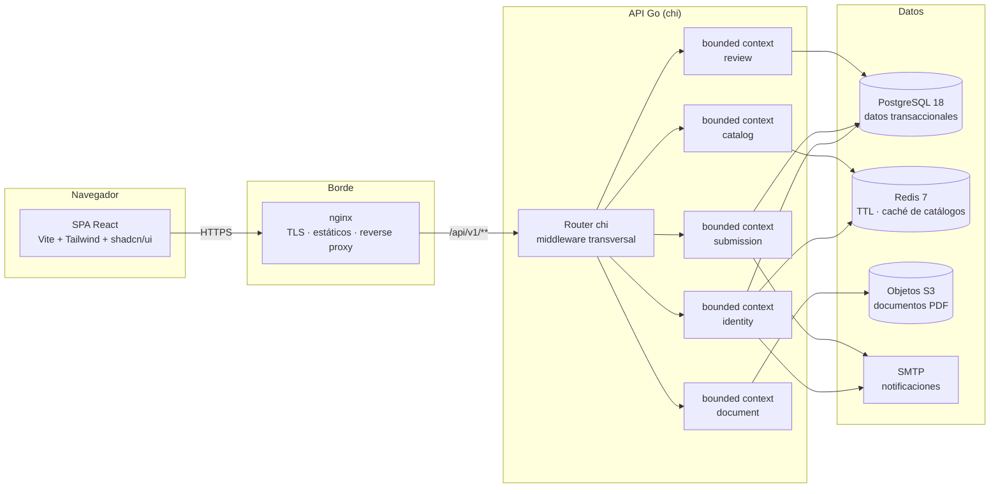
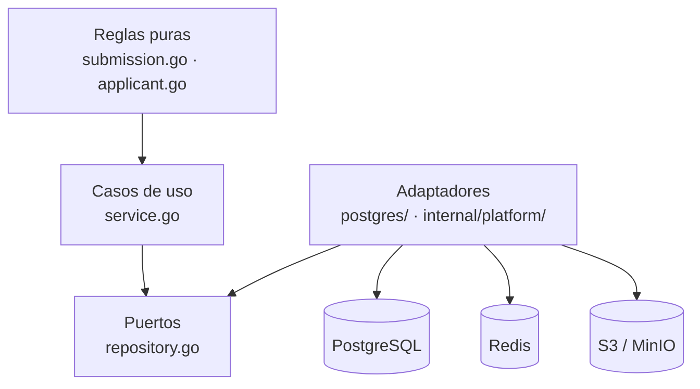
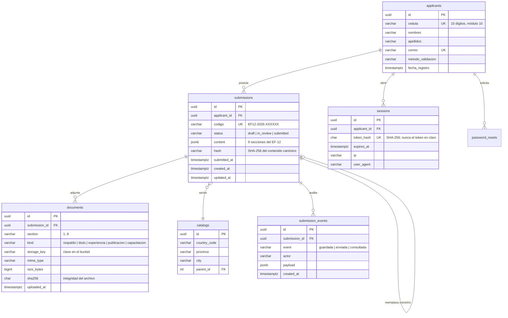
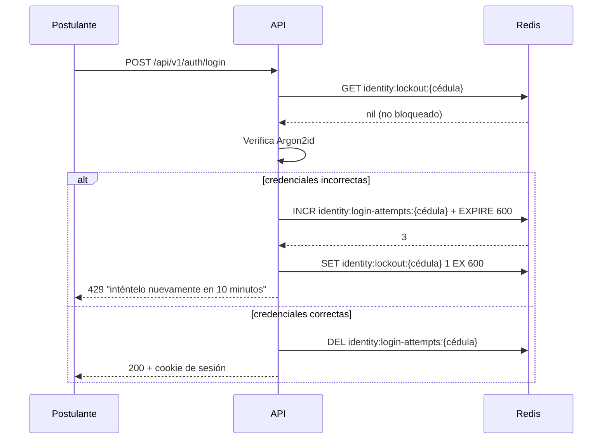
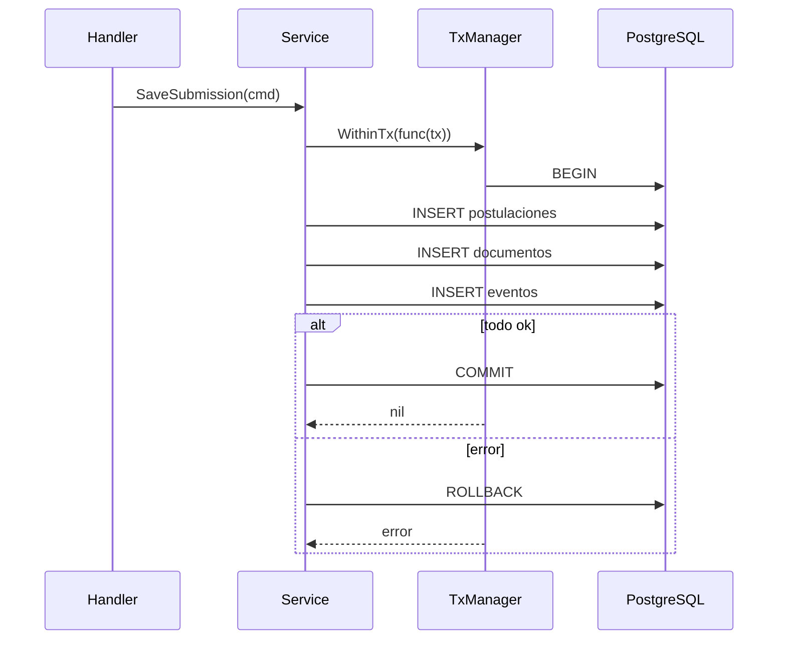

# Documento de Requisitos Técnicos (TRD)

**Sistema de Registro y Postulación al Directorio del BIESS**
Diseño de ingeniería e implementación del módulo inicial de registro y postulación

| Campo | Valor |
|---|---|
| Documento | TRD v1.0 |
| PRD asociado | [`../prd/PRD.md`](../prd/PRD.md) |
| Fuente funcional | `docs/requerimiento.txt` (texto del RF v1.4) |
| Stack | Go 1.27 · chi v5 · PostgreSQL 18 · Redis 7 · React 19 · Vite 8 · Tailwind v4 |

---

## 1. Visión general de la arquitectura

El sistema es un **monorepo pnpm** con dos aplicaciones y una raíz de
infraestructura compartida por Docker Compose.



### 1.1 Principios de diseño

1. **Bounded contexts**: cada contexto es dueño de su modelo y de sus
   reglas; no se comparten entidades entre contextos, solo contratos.
2. **Puertos y adaptadores (hexagonal)**: el dominio no importa
   infraestructura. Los puertos (interfaces) viven junto al caso de uso; los
   adaptadores (PostgreSQL, SMTP, S3, HTTP) viven en `postgres/` y en
   `internal/platform/`.
3. **Inyección de dependencias por constructor**: los casos de uso reciben sus
   colaboradores en el constructor; el cableado ocurre en un único lugar
   (`cmd/api/main.go`).
4. **Un solo origen en producción**: nginx sirve la SPA y reenvía `/api` a la
   API, de modo que no hay CORS ni cookies cross-origin.

---

## 2. Stack tecnológico y justificación

| Capa | Tecnología | Por qué |
|---|---|---|
| Frontend | React 19 + Vite 8 + TypeScript 6 | SPA con build rápido y tipado estricto |
| Estilos | Tailwind CSS v4 + shadcn/ui | Componentes accesibles y tema consistente, código propio en el repo |
| Estado remoto | TanStack Query | Cacheo, reintentos y estados de carga/error sin boilerplate |
| Routing | React Router v7 | Rutas protegidas por sesión |
| Backend | Go 1.27 + chi v5 | Ver [ADR-001](../decisions/ADR-001-chi-en-vez-de-gin-fiber.md) |
| Persistencia | PostgreSQL 18 + pgx v5 + sqlc | SQL explícito y tipos Go generados ([ADR-003](../decisions/ADR-003-postgres-sqlc-goose.md), [ADR-007](../decisions/ADR-007-postgresql-18-y-uuidv7.md)) |
| Migraciones | goose v3 | Migraciones embebidas en el binario, sin CLI en producción |
| Caché / TTL | Redis 7 | Bloqueo de intentos y caché de catálogos |
| Objetos | S3 / MinIO | Documentos PDF fuera del servidor de aplicación |
| Pruebas | Vitest (frontend) · `go test` (backend) | Pruebas unitarias de la lógica de negocio |
| CI | GitHub Actions | Formato, lint y tests por stack, con filtros por ruta |

### 2.1 Desviación respecto de la rúbrica: chi en lugar de Gin o Fiber

La rúbrica menciona *Fiber/Gin*. El proyecto usa **chi v5**, y la razón es
técnica: chi opera sobre `*http.Request` nativo, por lo que el mismo
`http.Handler` sirve para la API, para `multipart` y para los middlewares de la
stdlib, y no obliga a adaptadores. Fiber usa `fasthttp.RequestCtx` y carga
el cuerpo de la petición completo en memoria, lo que complica justamente las
subidas de PDF que exige el RF.

**Lo que la rúbrica evalúa no cambia**: la separación
Handler → Service → Repository con inyección de dependencias es la misma, y es
lo que se demuestra en el código. El detalle está en
[ADR-001](../decisions/ADR-001-chi-en-vez-de-gin-fiber.md).

---

## 3. Estructura del proyecto

```text
apps/
├── backend/                      # módulo Go independiente (no es paquete pnpm)
│   ├── cmd/
│   │   ├── api/                  # binario de la API: cableado + apagado ordenado
│   │   └── migrate/              # runner de migraciones (goose embebido)
│   ├── internal/
│   │   ├── platform/             # transversal, sin dominio de negocio
│   │   │   ├── config/           # configuración por entorno
│   │   │   ├── db/               # pool de PostgreSQL y gestor de transacciones
│   │   │   ├── httpx/            # router, middleware y respuestas JSON
│   │   │   ├── logger/           # log estructurado (slog)
│   │   │   ├── mail/             # remitente SMTP
│   │   │   ├── cache/            # cliente Redis (pendiente)
│   │   │   ├── storage/          # almacenamiento de objetos (local / S3)
│   │   │   └── sqlcgen/          # código generado por sqlc (no editar)
│   │   ├── shared/domain/        # kernel compartido: errores base y paginación
│   │   ├── identity/             # bounded context: postulante y cédula (resto pendiente)
│   │   ├── submission/           # bounded context: formulario EF-12 ✅
│   │   ├── document/             # bounded context: adjuntos PDF
│   │   ├── catalog/              # bounded context: catálogos geográficos (pendiente)
│   │   └── review/               # bounded context: administración y dashboard (pendiente)
│   ├── sql/
│   │   ├── migrations/           # migraciones goose (embebidas)
│   │   └── queries/              # esquema y queries de sqlc
│   └── sqlc.yaml
├── frontend/                     # SPA React
│   ├── src/
│   │   ├── components/ui/        # shadcn/ui (se regenera con el CLI)
│   │   ├── components/           # componentes propios
│   │   ├── pages/                # vistas por bounded context
│   │   ├── features/             # un módulo por capacidad (pendiente)
│   │   ├── lib/                  # cliente HTTP y configuración (pendiente)
│   │   ├── types/                # tipos del dominio EF-12
│   │   ├── utils/                # reglas puras (cédula, contraseña, duración)
│   │   └── data/                 # catálogos (provincias y cantones)
│   └── Dockerfile                # etapas dev (Vite) y prod (nginx)
├── deploy/                       # compose y nginx de producción
├── compose.yaml                  # compose de desarrollo
└── .github/workflows/ci.yml      # CI por stack
```

### 3.1 Reglas de dependencias

La granularidad es **por archivo dentro del contexto**, no por carpetas
`domain/`, `application/` e `infrastructure/`:



- Las **reglas puras** no importan nada de infraestructura: son funciones
  deterministas sobre valores.
- Los **casos de uso** conocen solo interfaces declaradas en el propio
  paquete.
- Los **adaptadores** implementan esas interfaces y traducen errores de la
  base de datos a errores de dominio.
- `shared/domain` solo contiene primitivas transversales (errores base,
  paginación). Nada de negocio.
- `internal/platform/` es transversal y **no** contiene reglas de negocio.
- Los contextos **no comparten entidades**: se referencian por identificador.

El detalle completo está en
[`../architecture/ARQUITECTURA.md`](../architecture/ARQUITECTURA.md) y en
[ADR-002](../decisions/ADR-002-bounded-contexts-y-hexagonal.md).

---

## 4. Modelo de datos



### 4.1 Decisiones de modelado

- **`content jsonb`**: las 9 secciones del EF-12 se guardan como un documento
  JSON. El formulario evoluciona con el RF y no obliga a migraciones por cada
  campo nuevo. Los datos que sí se consultan (código, sector, estado,
  postulante) tienen columna propia.
- **Claves foráneas reales**: `submissions.applicant_id` referencia
  `applicants.id` con `ON DELETE CASCADE`; no hay postulaciones huérfanas.
- **`sha256` en documentos**: permite verificar la integridad del archivo
  descargado contra el registrado en la postulación.
- **Historial de eventos**: tabla de auditoría append-only para reconstruir
  qué pasó con cada postulación.
- **`id` UUIDv7**: los identificadores se generan ordenados en el tiempo
  (RFC 9562). El motor PostgreSQL 18 trae `uuidv7()` de forma nativa, y la
  aplicación usa la misma versión con `uuid.NewV7()`. Ver
  [ADR-007](../decisions/ADR-007-postgresql-18-y-uuidv7.md).

---

## 5. API REST

- Base: `/api/v1`
- Formato: JSON en petición y respuesta, `Content-Type: application/json`
- Autenticación: cookie `session` `HttpOnly` + `SameSite=Lax`
- Errores: envelope estable `{ "error": { "codigo": "...", "mensaje": "..." } }`

Detalle completo en [`../api-contracts/API_CONTRACT.md`](../api-contracts/API_CONTRACT.md).

### 5.1 Paginación

| Estrategia | Parámetros | Respuesta | Uso |
|---|---|---|---|
| Offset | `page`, `pageSize` | `{ items, page, pageSize, total }` | Listas acotadas ("mis postulaciones") |
| Cursor (keyset) | `limit`, `cursor` | `{ items, nextCursor, hasMore, limit }` | Listas grandes (dashboard de revisión) |

El kernel vive en `internal/shared/domain/pagination.go` y los parsers en
`internal/platform/httpx/pagination.go`: ningún handler parsea la query string
a mano. Límite duro: **100 elementos por página**. El cursor es opaco: el
cliente lo reenvía, no lo interpreta.

---

## 6. Seguridad

| Control | Implementación |
|---|---|
| Hash de contraseña | Argon2id (64 MiB, t=3, p=2) con sal de 16 bytes aleatoria |
| Token de sesión | 32 bytes aleatorios en base64url; en la base solo el SHA-256 |
| Transporte de sesión | Cookie `HttpOnly; SameSite=Lax; Secure` en producción |
| CORS | Lista blanca explícita (`CORS_ALLOWED_ORIGINS`); vacío = denegar todo |
| Límite de cuerpo | 10 MiB por petición (`MAX_REQUEST_BODY_BYTES`) + límites por tipo de PDF |
| Panics | Middleware `Recover`: JSON 500, nunca una conexión cortada |
| Registro | Middleware de logging con `request_id` por petición |
| Secretos | Solo por variables de entorno; `.env` ignorado, `.env.example` versionado |
| Datos personales | No se registran en logs; no se versionan; documentos fuera del árbol de código |

---

### 6.1 Identidad adaptada mediante OTP

Registro y recuperación usan OTP de seis dígitos enviado por SMTP, TTL actual de
diez minutos, cédula validada por módulo 10 y método `otp_correo`. No se solicita
fecha de expedición ni código dactilar. Los datos de EF-12 no se presentan como
verificados por Registro Civil. La adaptación está aprobada en ADR-008; T16 cubre
los controles pendientes de vinculación, propósito, consumo atómico y reenvío.
El detalle de endpoints vigentes está en el contrato, sección 5.

## 7. Caché y control de intentos (Redis)

**Objetivo**: cumplir el EF-11 (3 intentos → bloqueo de 10 minutos) y cachear
los catálogos geográficos, que se consultan en cada render del formulario.

### 7.1 Claves

| Clave | Tipo | TTL | Contenido |
|---|---|---|---|
| `identity:login-attempts:{cédula}` | String (contador) | 10 min | Intentos fallidos consecutivos |
| `identity:lockout:{cédula}` | String | 10 min | Marca de bloqueo |
| `catalog:countries` | String (JSON) | 24 h | Lista de países |
| `catalog:provinces:{country}` | String (JSON) | 24 h | Provincias del país |
| `catalog:cities:{country}:{province}` | String (JSON) | 24 h | Cantones |

### 7.2 Algoritmo de bloqueo



La clave de intentos **caduca sola**: al cumplirse los 10 minutos sin
reiniciar nada, el postulante puede volver a intentar.

> **Estado**: este módulo es el siguiente paso pendiente. El kernel de
> paginación y el resto de la arquitectura ya lo soportan; ver
> [`../tasks/backend-tasks.md`](../tasks/backend-tasks.md).

---

## 8. Transacciones

El guardado de una postulación es **multi-tabla**: cabecera, secciones del
formulario, documentos adjuntos y eventos de auditoría. Debe ser atómico.



`db.TxManager` (en `internal/platform/db`) encapsula `BEGIN` / `COMMIT` /
`ROLLBACK` con `pgx`, de modo que el caso de uso no conoce el gestor de
transacciones.

---

## 9. Almacenamiento de documentos

| Aspecto | Decisión |
|---|---|
| Ubicación | Bucket S3 (MinIO en desarrollo), **fuera** del servidor de aplicación |
| Clave | `{submission_id}/{section}/{uuid}.pdf` — no adivinable |
| Validación | MIME `application/pdf`, tamaño por tipo (2 MB / 4 MB) y total (50 MB) |
| Integridad | SHA-256 del archivo registrado en `documents.sha256` |
| Descarga | URL prefirmada de corta duración; la API nunca hace proxy del binario |

En desarrollo, `internal/platform/storage` permite un backend local en disco
para no depender de MinIO. El comando `go run ./cmd/api storage` ejecuta un
servidor separado que entrega únicamente URLs HMAC temporales; la API no sirve
el binario. El adaptador S3 usa endpoints con bucket incluido y firma SigV4.
La configuración y los permisos se detallan en `api-contracts/API_CONTRACT.md`.

---

## 10. Despliegue

| Entorno | Orquestación | Notas |
|---|---|---|
| Desarrollo | `compose.yaml` (raíz) | api, frontend (Vite), postgres, mailpit |
| Producción | `deploy/compose.yaml` | nginx (SPA + `/api`), api, postgres; variables en `deploy/.env` |

- Un solo origen en producción: nginx sirve la SPA y reenvía `/api`, sin CORS.
- La imagen de la API es `distroless`; el propio binario actúa como sonda de
  salud (`api healthcheck`).
- Detalle operativo en
  [`../deployment/LOCAL_DEPLOYMENT.md`](../deployment/LOCAL_DEPLOYMENT.md) y
  [`../deployment/PRODUCTION_DEPLOYMENT.md`](../deployment/PRODUCTION_DEPLOYMENT.md).

---

## 11. CI/CD y calidad

| Job | Comprobaciones |
|---|---|
| `backend` | `gofmt`, `go vet`, `go test -race` con cobertura, y que el código de `sqlc` esté al día |
| `frontend` | `prettier --check`, `eslint`, `vitest run`, `tsc -b` + `vite build` |

Los jobs se activan **solo si cambió su stack** (más los archivos de la raíz
que afectan al frontend: `package.json`, `pnpm-lock.yaml`,
`pnpm-workspace.yaml`). El pipeline no depende de acciones de terceros más allá
de las oficiales de GitHub.

---

## 12. Decisiones de arquitectura

| ADR | Decisión |
|---|---|
| [ADR-001](../decisions/ADR-001-chi-en-vez-de-gin-fiber.md) | chi v5 en lugar de Gin o Fiber |
| [ADR-002](../decisions/ADR-002-bounded-contexts-y-hexagonal.md) | Bounded contexts con puertos y adaptadores |
| [ADR-003](../decisions/ADR-003-postgres-sqlc-goose.md) | PostgreSQL + sqlc + goose |
| [ADR-004](../decisions/ADR-004-ingles-en-codigo-espanol-en-comentarios.md) | Identificadores en inglés, comentarios en español |
| [ADR-005](../decisions/ADR-005-paginacion-offset-y-cursor.md) | Paginación offset y cursor sobre un kernel compartido |
| [ADR-006](../decisions/ADR-006-sesiones-en-base-de-datos.md) | Sesiones en PostgreSQL con cookie `HttpOnly` |
| [ADR-007](../decisions/ADR-007-postgresql-18-y-uuidv7.md) | PostgreSQL 18 y UUIDv7 como estrategia de identificadores |

---

**Ver también**: [`../prd/PRD.md`](../prd/PRD.md) ·
[`../architecture/ARQUITECTURA.md`](../architecture/ARQUITECTURA.md) ·
[`../database/SCHEMA.md`](../database/SCHEMA.md)
